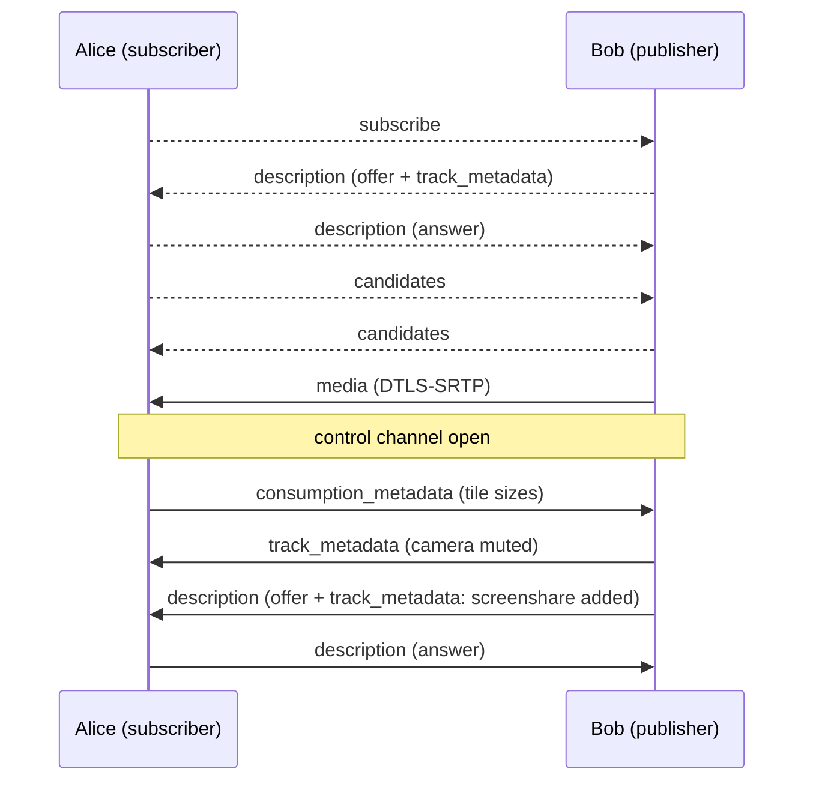

# MSC4575: Full mesh transport for MatrixRTC

[MSC4143] introduces MatrixRTC. Concrete transports are defined in separate proposals. [MSC4195] defines an
SFU-based transport (LiveKit). This proposal defines a peer-to-peer transport. It is less efficient, as it
needs more upload and download bandwidth, but it is easier to host: many homeservers already have all the
infrastructure set up, because it is the same as for 1:1 calls as currently (2026) defined in the spec.

Every subscriber opens a direct WebRTC connection to every publisher it wants to receive media from.
No server-side infrastructure is needed apart from the TURN servers homeservers already provide for [VoIP].

The transport only covers establishing WebRTC connections between two MatrixRTC members. Calls, ringing,
invites and membership are all handled by [MSC4143] and the respective RTC applications like `m.call` ([MSC4196]).

[MSC4143]: https://github.com/matrix-org/matrix-spec-proposals/pull/4143
[MSC4195]: https://github.com/matrix-org/matrix-spec-proposals/pull/4195
[VoIP]: https://spec.matrix.org/v1.18/client-server-api/#voice-over-ip
[MSC4196]: https://github.com/matrix-org/matrix-spec-proposals/pull/4196

## Proposal

### Transport type

A new transport type `m.full_mesh` is introduced. A member publishing on it adds the following data
to `transports.published` in its `m.rtc.member` event:

- `type` (required, string): `m.full_mesh`.
- `device_id` (required, string): The device ID of the publishing client.

Members able to subscribe add `m.full_mesh` to `transports.can_subscribe`.

```json5
{
  "type": "m.rtc.member",
  "content": {
    "slot_id": "m.call#room",
    "member": { "id": "xyzABCDEF10123", "membership": "join" },
    "application": { "type": "m.call" },
    "transports": {
      "published": [{ "type": "m.full_mesh", "device_id": "ABCDEFGHIJ" }],
      "can_subscribe": ["m.full_mesh", "m.livekit"]
    },
    "sticky_key": "xyzABCDEF10123"
  }
}
```

Clients MUST ignore an `m.full_mesh` transport whose `device_id` isn't the device that
sent the `m.rtc.member` event. (This only applies in encrypted rooms, where the sending device is known
from the encryption metadata.)

A member MUST NOT list more than one `m.full_mesh` object in `transports.published`.

Servers don't need to advertise `m.full_mesh` in `/_matrix/client/v1/rtc/transports`.

### Connection model

Each WebRTC connection is **unidirectional** and belongs to exactly one *(subscriber, publisher)* pair of
MatrixRTC members:

- The **subscriber** starts the connection by requesting media.
- The **publisher** is always the SDP offerer and the only one sending media and data. The subscriber
  only receives them, except on the [control channel](#control-channel), which carries control
  messages[^1] in both directions.
- If two members subscribe to each other, they use two independent connections.

This lets transports be mixed per direction. Alice can subscribe to Bob over `m.full_mesh` while Bob
subscribes to Alice over `m.livekit`. Only the publisher creates offers. This gives clear ownership, so
there is no glare.

Only one connection is allowed to exist per (subscriber `member.id`, publisher `member.id`) pair.

Only the connection's initial setup uses [to-device messages](#to-device-messages). After that,
all signalling goes directly between the peers over the connection's [control channel](#control-channel).

[^1]: Control messages announce changes, like a new track or a mute, and tell the publisher how the
subscriber shows each track. See [control messages](#control-messages).

### TURN servers

Each client gets ICE servers from its own homeserver as described in
[`GET /_matrix/client/v3/voip/turnServer`][turnServer]. A client passes `uris`, `username` and
`password` to every `RTCPeerConnection` it creates.

Clients SHOULD fetch the credentials again before `ttl` expires and use the new ones for new connections.
Clients use host and server-reflexive candidates only.

They MUST NOT fall back to a third-party STUN/TURN server without user consent.

[turnServer]: https://spec.matrix.org/v1.18/client-server-api/#get_matrixclientv3voipturnserver

### Tracks and metadata

The publisher sends each audio, video or data track on its own transceiver. Both sides identify a track by the
`mid` of its transceiver in the SDP. The following two metadata objects are keyed by `mid`.
Custom applications MAY add new properties.

#### Track metadata (publisher → subscriber)

`track_metadata` describes every track the publisher currently sends:

- `purpose` (required, string): `m.usermedia` or `m.screenshare`, as in [VoIP]. Together with the
  track's media type, it tells a microphone from a camera, or a screenshare from its audio.
  Applications MAY define more purposes. Subscribers MUST ignore tracks whose purpose they don't know.
- `muted` (boolean): Whether the track is muted on purpose. Defaults to `false`.

```json5
"track_metadata": {
  "0": { "purpose": "m.usermedia" },
  "1": { "purpose": "m.usermedia", "muted": true },
  "2": { "purpose": "m.screenshare" }
}
```

Publishers SHOULD put tracks that belong together, like a microphone and a camera, in one `MediaStream`
(`a=msid`), so that the subscriber's browser plays them in sync.

#### Consumption metadata (subscriber → publisher)

`consumption_metadata` tells the publisher how their tracks are used. This allows a publisher to stop
sending what nobody looks at, or to send it at a lower resolution:

- `in_use` (boolean): Whether the subscriber uses the track. Defaults to `true`. While it is `false`, the
  publisher SHOULD send nothing on the track (`replaceTrack(null)`), which needs no renegotiation to undo.
- `max_width`, `max_height` (integer): The largest size, in device pixels, at which the subscriber shows
  the video. The publisher SHOULD scale its video down to fit, for example with `scaleResolutionDownBy`
  in `RTCRtpSender.setParameters()`.

Tracks that aren't listed use the defaults. These are hints: the publisher MAY ignore them.

```json5
"consumption_metadata": {
  "1": { "max_width": 320, "max_height": 180 },
  "2": { "in_use": false }
}
```

#### Data channels

The publisher MAY open further data channels for application data. It sets each channel's
[`protocol`][RTCDataChannelInit], which WebRTC sends to the subscriber together with the channel
([RFC 8832]), to an identifier in the [Common Namespaced Identifier Grammar] naming what the channel
carries and how. Subscribers MUST ignore channels whose protocol they don't know.

This proposal defines no protocols. Each MatrixRTC application, like `m.call` ([MSC4196]), defines the
protocols it uses, and a client MAY use its own namespaced protocols for features of its own.

[RTCDataChannelInit]: https://www.w3.org/TR/webrtc/#dom-rtcdatachannelinit-protocol
[RFC 8832]: https://www.rfc-editor.org/rfc/rfc8832
[Common Namespaced Identifier Grammar]: https://spec.matrix.org/v1.16/appendices/#common-namespaced-identifier-grammar

### To-device messages

All signalling uses [to-device messages] sent to the single device of the target member. Messages MUST be
Olm-encrypted. Recipients MUST discard messages sent in cleartext.

[to-device messages]: https://spec.matrix.org/v1.18/client-server-api/#send-to-device-messaging

Every message contains these common properties:

- `room_id` (required, string): The room containing the slot.
- `slot_id` (required, string): The ID of the slot.
- `member_id` (required, string): The sender's `member.id`.
- `claimed_device_id` (required, string): The sender's device ID, which replies are sent to. SDKs and the widget
  API often don't expose the Olm sending device, so the sender states it, as [MSC4143]'s reference
  implementation does.
- `target_member_id` (required, string): The recipient's `member.id`.
- `connection_id` (required, string): A random identifier the subscriber generates for each subscription
  attempt. All messages of the connection use it.
- `seq` (required, integer): Starts at `0` for each (`member_id`, `target_member_id`) pair and goes up by
  `1` with every message between them, across connections. To-device messages can arrive out of order, so
  recipients MUST process them in `seq` order, buffering until gaps are filled. A gap that isn't filled
  within a short timeout (RECOMMENDED: 10 seconds) is skipped.

Recipients MUST discard a message if any of these is true:

- `room_id` and `slot_id` don't match a session that both members are in.
- `target_member_id` is not their own current `member.id`.
- No joined `m.rtc.member` event matches `member_id`.
- That event's sender is not the sender of the to-device message.
- `claimed_device_id` is not the device that event belongs to.
- The client knows the Olm sending device of the to-device message, and it differs from `claimed_device_id`.
- The message is not `m.rtc.full_mesh.subscribe` and its `connection_id` is not the current connection
  for this member pair. This drops late messages belonging to a replaced or closed connection.

A subscribe request MAY arrive before the subscriber's `m.rtc.member` event. Publishers SHOULD keep such
a request for a short grace period (RECOMMENDED: 10 seconds) before discarding it.

#### `m.rtc.full_mesh.subscribe` (subscriber → publisher)

Asks the publisher to open a connection. It contains only the [common properties](#to-device-messages).

#### `m.rtc.full_mesh.description` (both directions)

Carries an SDP offer (publisher → subscriber) or answer (subscriber → publisher) until the
[control channel](#control-channel) is open. Usually that is just the initial offer and answer, but the
publisher may renegotiate before the channel opens, for example when a screenshare starts during ICE.

It contains the [common properties](#to-device-messages) and:

- `description` (required, object): An [`RTCSessionDescriptionInit`].
  - `type` (required, string): `offer` or `answer`.
  - `sdp` (required, string): The SDP.
- `track_metadata` (object): REQUIRED on offers. The publisher's
  [track metadata](#track-metadata-publisher--subscriber) once the offer is applied.

```json5
{
  // Common properties
  "room_id": "!room:example.org",
  "slot_id": "m.call#room",
  "member_id": "bobMemberId",
  "claimed_device_id": "BOBDEVICE",
  "target_member_id": "aliceMemberId",
  "connection_id": "c0nn3ct10n1d",
  "seq": 0,

  // Specific to m.rtc.full_mesh.description
  "description": { "type": "offer", "sdp": "v=0\r\n..." },
  "track_metadata": {
    "0": { "purpose": "m.usermedia" },
    "1": { "purpose": "m.usermedia", "muted": true }
  }
}
```

#### `m.rtc.full_mesh.candidates` (both directions)

Carries trickled ICE candidates until the control channel is open.

It contains the [common properties](#to-device-messages) and:

- `candidates` (required, array): An array of [`RTCIceCandidateInit`] objects (`candidate`, `sdpMid`,
  `sdpMLineIndex`, `usernameFragment`). A `candidate` set to the empty string signals end-of-candidates.

Clients SHOULD collect candidates for a short time (for example 200ms) and send them in one message.
Candidates are gathered after the local description is set, so `seq` orders them after their
description. Recipients MUST still wait for `setRemoteDescription` to complete before adding them.

#### `m.rtc.full_mesh.close` (both directions)

Closes the connection. The recipient closes the corresponding `RTCPeerConnection`.

It contains the [common properties](#to-device-messages) and:

- `reason` (string): An optional human-readable reason.

`close` is always a to-device message, even when the control channel is open, because closing the peer
connection would race a channel message.

[`RTCSessionDescriptionInit`]: https://www.w3.org/TR/webrtc/#dom-rtcsessiondescriptioninit
[`RTCIceCandidateInit`]: https://www.w3.org/TR/webrtc/#dom-rtcicecandidateinit

### Control channel

Every connection has exactly one **control channel**: a WebRTC data channel for signalling once the
connection is up. It is set up as follows:

- `label`: `m.rtc.full_mesh.control`.
- `negotiated`: `true`, with `id`: `0`. Both sides create it themselves, so it opens with the connection,
  without the round trip of an `ondatachannel` announcement.
- Ordered and reliable (the defaults).

The publisher creates the channel before its first offer, so that the offer contains the connection's
`m=application` section. The subscriber creates its side right after applying that offer.

ID `0` is reserved for it. [Data channels](#data-channels) are announced in-band (`negotiated: false`)
and get their IDs from the browser.

#### Control messages

Each message is one UTF-8 JSON object, sent as a text message, with a `type` property:

| `type` | Direction | Content |
| ------ | --------- | ------- |
| `track_metadata` | publisher → subscriber | `track_metadata`: the complete current [track metadata](#track-metadata-publisher--subscriber). |
| `consumption_metadata` | subscriber → publisher | `consumption_metadata`: the complete current [consumption metadata](#consumption-metadata-subscriber--publisher). |
| `description` | both | `description`: an [`RTCSessionDescriptionInit`]. Offers come from the publisher and also contain its `track_metadata`, as in [`m.rtc.full_mesh.description`](#mrtcfull_meshdescription-both-directions). Answers come from the subscriber. |
| `candidates` | both | `candidates`: as in [`m.rtc.full_mesh.candidates`](#mrtcfull_meshcandidates-both-directions). |

Each metadata message replaces the previous one. Receivers MUST ignore messages with an unknown `type`,
so that future versions can add types.

The channel is ordered, reliable and belongs to one connection, so messages need no `seq` or
`connection_id`.

Once a side has [switched to the control channel](#switching-to-the-control-channel), it MUST send every
message of the connection over it, apart from `close`. A single ordered path keeps updates from racing
each other. If the channel closes, the connection has [failed](#failure).

#### Changing tracks

- **Muting or unmuting:** the publisher sends `track_metadata`. No renegotiation.
- **Adding or removing a track:** the publisher sends an offer with the new `track_metadata`, which the
  subscriber answers. No track arrives without its metadata.
- **Adding or removing a data channel:** the publisher opens or closes it. No renegotiation.

The publisher MUST NOT send a new offer while a previous one is still unanswered (signalling state not
`stable`). Instead it waits for the answer and combines all changes made in the meantime into one offer.

#### Switching to the control channel

The subscriber starts using the control channel as soon as it is open.

The publisher can only start using the control channel once all its to-device offers have been
answered, to avoid races: a to-device message can arrive after channel messages sent later, so a late
offer could overwrite newer metadata. The publisher switches once the channel is open and no offer it
sent as a to-device message is waiting for an answer.

Until then, both sides send offers, answers and candidates as to-device messages. Metadata has no
to-device message of its own. If the publisher's track metadata changes without a new offer, for example
on a mute, it sends its current `track_metadata` when it switches. The subscriber sends its first
`consumption_metadata` when it switches. Until that arrives, the publisher sends every track at full
size.

After switching, both sides MUST still accept `m.rtc.full_mesh.description` and
`m.rtc.full_mesh.candidates` of the current connection: messages sent before the switch can arrive
late.

### Procedures

This section walks through an example to summarise the previous sections and make them more concrete.

#### Subscribing

A subscriber (Alice) that wants media from a joined member (Bob) whose `transports.published` contains an
`m.full_mesh` object:

1. Alice creates a new `connection_id` (random) and sends `m.rtc.full_mesh.subscribe` to Bob's `device_id`.
2. Bob validates the request as described above. If Bob doesn't publish `m.full_mesh`, or the request is
   invalid, Bob MAY reply with `m.rtc.full_mesh.close`. If Bob already has a connection for Alice's
   `member.id`, he closes it and replaces it with the new one.
3. Bob creates an `RTCPeerConnection` using his own ICE servers, creates the control channel, and adds
   his current tracks as `sendonly`. He then creates an offer, sets it as the local description and sends
   it with `track_metadata` in an `m.rtc.full_mesh.description` message.
4. Alice creates an `RTCPeerConnection` using her own ICE servers and sets the offer as the remote
   description. She creates her side of the control channel. She then creates an answer (`recvonly`),
   sets it as the local description and sends it in an `m.rtc.full_mesh.description` message.
5. Both sides send `m.rtc.full_mesh.candidates` as they gather candidates.
6. Once the connection is up, the control channel opens. All further signalling uses it, starting with
   Alice's `consumption_metadata`.



Dashed arrows are to-device messages. Solid arrows go directly between the peers.

#### Closing

- The subscriber sends `m.rtc.full_mesh.close` when it no longer wants the media, or when the publisher
  leaves the slot or stops publishing `m.full_mesh`.
- The publisher sends `m.rtc.full_mesh.close` when it stops publishing `m.full_mesh`, or when the
  subscriber is no longer considered joined as per [MSC4143]. Publishers MUST stop sending media to
  members that are no longer joined.
- Leaving the slot closes all of a member's connections.

#### Failure

If a connection's ICE state becomes `failed`, or its control channel closes, the subscriber MAY send
`m.rtc.full_mesh.close` and then subscribe again with a new `connection_id`. It SHOULD use exponential
backoff between attempts.

Publishers don't retry. If the control channel of a connection closes, the publisher closes the
connection and sends `m.rtc.full_mesh.close`: without the channel it can't announce changes, so it
shouldn't keep sending media that the subscriber can't interpret.

### End-to-end encryption

WebRTC always encrypts media with DTLS-SRTP (data channels with DTLS). Each side's DTLS certificate
fingerprint is part of its SDP.
 - The SDP is carried in Olm-encrypted to-device messages.
 - Recipients check that the sending device matches the member's `m.rtc.member` event.

As a result, the fingerprints are authenticated end to end between the two member devices, and everything
on the connection is end-to-end encrypted.
This also holds for renegotiation offers: they arrive either over Olm like the first one, or over the
control channel, which that DTLS session authenticates.

TURN servers don't weaken the encryption. They only relay packets and can't decrypt or alter the media,
because they don't take part in the DTLS handshake. They do see the peers' IP addresses and the
traffic's timing and volume.

DTLS uses an ephemeral key exchange, so every connection also has forward secrecy.

`m.full_mesh` therefore doesn't use the `m.per_member` key material from [MSC4143], and its required key
length is 0 bytes. A client whose published transports are all `m.full_mesh` doesn't need to send
`m.rtc.encryption_key` messages. Media received over a connection that was set up as described above
counts as encrypted for the purposes of [MSC4143].

## Potential issues

### Scalability

Every publisher uploads one copy of its media per subscriber, and the number of connections grows
quadratically with the number of members. The transport is only suitable for small sessions. Clients MAY
refuse subscriptions beyond a limit they choose. Consumption metadata reduces the bandwidth, not the
quadratic growth.

### To-device latency

Connection setup needs about two to-device round trips, possibly over federation. This is slower than
connecting to an SFU. Once the control channel is open, nothing goes through the homeserver any more.
Media can flow slightly before that, because it only needs DTLS while the channel needs SCTP on top, so
a few candidates may still go through the homeserver after the first frames arrive.

### Twice the connections for bidirectional media

Using one connection per direction doubles the number of ICE and DTLS handshakes between two members who
both publish and subscribe. In return, transports can be mixed and there is no glare.

## Alternatives

### One bidirectional connection per pair

[MSC3401] used one connection per pair of members, with a tie-break rule for who calls whom. This halves
the number of connections. However, it ties both directions to the same transport and needs glare
handling for renegotiation.

[MSC3401]: https://github.com/matrix-org/matrix-spec-proposals/pull/3401

### Subscriber as offerer

The subscriber could send an offer with `recvonly` transceivers directly, saving one message. However, the
subscriber doesn't know how many tracks the publisher has, so the publisher would need to make offers
for renegotiation anyway. Making the publisher the only offerer keeps a single code path.

### Reusing `m.call.*` events

The legacy `m.call.invite`, `m.call.answer` and similar events bring call IDs, party IDs, invite lifetimes
and ringing semantics. MatrixRTC already handles all of these, so the events were not reused.

### Using `m.per_member` keys with SFrame

Media could also be encrypted with the [MSC4143] key material on top of DTLS-SRTP. This adds no security
over authenticated DTLS-SRTP, so it is not required.

### Updates over to-device messages

Updates such as mute changes could be to-device messages. Every one would then go through the
homeserver, possibly over federation, once per subscriber, and lag behind the media.

### Inferring mute from the media

A receiver could treat a track without packets as muted. That can't tell a camera turned off from a bad
network, and a muted track may still send silence or black frames.

### Mixing data into the control channel

Application data could be another message type on the control channel. Separate data channels keep it
from delaying signalling and can each choose their reliability.

### Metadata per stream

The legacy [VoIP] `sdp_stream_metadata` describes each `MediaStream`, with a purpose and separate audio
and video mute flags. This proposal keeps the purposes but describes tracks. A stream mixes audio and
video, so per-stream consumption metadata couldn't stop a video while keeping its audio, which is what a
subscriber wants for a member it doesn't show. Keyed by `mid`, every property belongs to exactly one
track. The browser already groups tracks by `msid`.

Describing data channels in the metadata as well would repeat the channel's own `protocol`, and could
arrive after the channel: each data channel is a separate SCTP stream, and SCTP doesn't order messages
across streams.

## Security considerations

### IP address exposure

Peers learn each other's IP addresses from ICE candidates. Clients MAY set `iceTransportPolicy: "relay"`
so that only their homeserver's TURN server is exposed, at the cost of more latency. Candidates are only
sent through Olm-encrypted to-device messages or the DTLS-protected control channel, and only to members
that are joined to the slot.

### Unencrypted rooms

In unencrypted rooms, `m.rtc.member` events are not authenticated. A malicious homeserver could forge a
member event with a `device_id` it controls and receive media. Signalling itself stays Olm-encrypted, so
existing connections can't be tampered with. Clients SHOULD only send to devices that are cross-signed
by their owner, as described in [MSC4153].

[MSC4153]: https://github.com/matrix-org/matrix-spec-proposals/pull/4153

### Claimed device IDs

A recipient that can't check `claimed_device_id` against the Olm sending device only knows that the message
comes from the right user. Another device of that same user could pretend to be the device of the
member and receive its media. Only that user's own devices can do this, the same as for `claimed_device_id`
in [MSC4143]'s reference implementation. Clients SHOULD check the Olm sending device wherever their SDK
exposes it.

### Removed members

Publishers stop sending media when a subscriber is no longer joined. This way, redacting member events
or removing someone from the room also cuts their media.

### Untrusted metadata

The control channel only connects the two members of the connection, but each side can still send
anything over it. Receivers MUST validate metadata before acting on it, for example by bounding
`max_width` and `max_height`. They MUST NOT treat a `purpose` or `protocol` as permission to do more than
the application would allow anyway.

## Unstable prefix

| Stable identifier | Purpose | Unstable identifier |
| ----------------- | ------- | ------------------- |
| `m.full_mesh` | Transport type | `org.matrix.msc4575.full_mesh` |
| `m.rtc.full_mesh.subscribe` | To-device event type | `org.matrix.msc4575.rtc.full_mesh.subscribe` |
| `m.rtc.full_mesh.description` | To-device event type | `org.matrix.msc4575.rtc.full_mesh.description` |
| `m.rtc.full_mesh.candidates` | To-device event type | `org.matrix.msc4575.rtc.full_mesh.candidates` |
| `m.rtc.full_mesh.close` | To-device event type | `org.matrix.msc4575.rtc.full_mesh.close` |
| `m.rtc.full_mesh.control` | Control channel label | `org.matrix.msc4575.rtc.full_mesh.control` |

## Dependencies

This proposal depends on [MSC4143].
