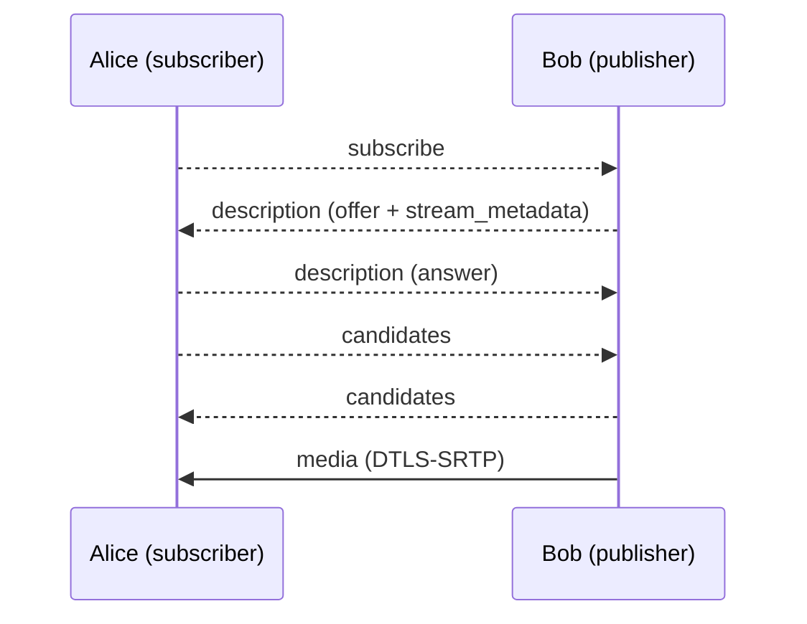

# MSCXXXX: Full mesh transport for MatrixRTC

[MSC4143] introduces MatrixRTC. Concrete transports are defined in seperate proposals. [MSC4195] defines an
SFU based transport (livekit). This proposal defines a peer-to-peer transport.

In one sentence:\
Every subscriber opens a direct WebRTC connection to every publisher it wants to receive media from. No server-side infrastructure is
needed apart from the TURN servers homeservers already provide for [VoIP].

The transport only covers establishing WebRTC connections between two MatrixRTC members. Calls, ringing,
invites, call IDs and membership are all handled by [MSC4143] and the respective application.

[MSC4143]: https://github.com/matrix-org/matrix-spec-proposals/pull/4143
[MSC4195]: https://github.com/matrix-org/matrix-spec-proposals/pull/4195
[VoIP]: https://spec.matrix.org/v1.18/client-server-api/#voice-over-ip

## Proposal

### Transport type

A new transport type `m.full_mesh` is introduced. A member publishing on it adds the following data
to `transports.published` in its `m.rtc.member` event:

- `type` (required, string): `m.full_mesh`.
- `device_id` (required, string): The device ID of the publishing client. Needed for unencrypted rooms
  (We can only resolve the device id of room events from the olm session info)

Members able to subscribe add `m.full_mesh` to `transports.can_subscribe`.

```json5
{
  "type": "m.rtc.member",
  "content": {
    "slot_id": "m.call#room",
    "member": { "id": "xyzABCDEF10123", "membership": "join" },
    "application": { "type": "m.call" },
    "transports": {
      "published": [{ "type": "m.full_mesh", "device_id": "ABCDEFGHIJ" }],
      "can_subscribe": ["m.full_mesh", "m.livekit"]
    },
    "sticky_key": "xyzABCDEF10123"
  }
}
```

In encrypted rooms, clients MUST ignore transports in `published` with a `device_id` mismatch.
`transports.published.device_id` different to the device that sent the `m.rtc.member` event.

A member MUST NOT list more than one `m.full_mesh` object in `transports.published`.

Servers don't need to advertise `m.full_mesh` in `/_matrix/client/v1/rtc/transports`.

### Connection model

Each WebRTC connection is **unidirectional** and belongs to exactly one *(subscriber, publisher)* pair of
MatrixRTC members:

- The **subscriber** starts the connection by asking the publisher for its media.
- The **publisher** is always the SDP offerer and only sends media. The subscriber only receives media.
- If two members subscribe to each other, they use two independent connections.

This lets transports be mixed per direction. Alice can subscribe to Bob over `m.full_mesh` while Bob
subscribes to Alice over `m.livekit`. Because only the publisher creates offers, there is no glare.

At most one connection exists per (subscriber `member.id`, publisher `member.id`) pair.

### TURN servers

Each client gets ICE servers from its own homeserver via the existing
[`GET /_matrix/client/v3/voip/turnServer`][turnServer] endpoint and passes `uris`, `username` and
`password` to every `RTCPeerConnection` it creates. Clients SHOULD fetch the credentials again before
`ttl` expires and use the new ones for new connections. If the response is empty, the homeserver has no
TURN server. Clients then use host and server-reflexive candidates only. They MUST NOT fall back to a
third-party STUN/TURN server without user consent.

[turnServer]: https://spec.matrix.org/v1.18/client-server-api/#get_matrixclientv3voipturnserver

### To-device messages

All signalling uses [to-device messages] sent to the single device of the target member. Messages MUST be
Olm-encrypted. Recipients MUST discard messages sent in cleartext.

[to-device messages]: https://spec.matrix.org/v1.18/client-server-api/#send-to-device-messaging

Every message contains these common properties:

- `room_id` (required, string): The room containing the slot.
- `slot_id` (required, string): The ID of the slot.
- `member_id` (required, string): The sender's `member.id`.
- `device_id` (required, string): The sender's device ID. The publisher replies to this device, even when
  the subscriber doesn't publish `m.full_mesh` and so has no `device_id` in its transport. Clients often
  can't get the Olm sending device of a to-device message from their SDK or the widget API, so the sender
  states it here. This is the same approach as `claimed_device_id` in the reference implementation of
  [MSC4143].
- `target_member_id` (required, string): The recipient's `member.id`.
- `connection_id` (required, string): A random identifier the subscriber generates for each subscription
  attempt. All messages of the connection use it.
- `seq` (required, integer): Starts at `0` for each (`member_id`, `target_member_id`) pair and goes up by
  `1` with every message sent from `member_id` to `target_member_id`. It is *not* reset when a new
  `connection_id` is used, so messages are ordered across reconnections too. To-device messages are not
  guaranteed to arrive in order. Recipients MUST therefore process messages in `seq` order and buffer
  them until any gaps are filled. If a gap is not filled within a short timeout (RECOMMENDED: 10
  seconds), recipients MUST skip the missing messages and continue with the buffered ones.

Recipients MUST discard a message if any of these is true:

- `room_id` does not match the room of an active shared (between the sender and receiver) rtc session.
- `slot_id` does not match the slot of an active shared rtc session.
- `target_member_id` is not their own current `member.id`.
- No joined `m.rtc.member` event matches `member_id`.
- That event's sender is not the sender of the to-device message.
- `device_id` is not the device that event belongs to.
- The client knows the Olm sending device of the to-device message, and it differs from `device_id`.
- The message is not `m.rtc.full_mesh.subscribe` and its `connection_id` is not the current connection
  for this member pair. This drops late messages belonging to a replaced or closed connection.

A subscribe request MAY arrive before the subscriber's `m.rtc.member` event. Publishers SHOULD keep such
a request for a short grace period (RECOMMENDED: 10 seconds) before discarding it.

#### `m.rtc.full_mesh.subscribe` (subscriber → publisher)

Asks the publisher to open a connection and send its media. It contains only the common properties.

#### `m.rtc.full_mesh.description` (both directions)

Carries an SDP offer (publisher → subscriber) or answer (subscriber → publisher).

- `description` (required, object): An [`RTCSessionDescriptionInit`].
  - `type` (required, string): `offer` or `answer`.
  - `sdp` (required, string): The SDP.
- `stream_metadata` (object): REQUIRED on offers. See [stream metadata](#stream-metadata).

```json5
{
  "room_id": "!room:example.org",
  "slot_id": "m.call#room",
  "member_id": "bobMemberId",
  "device_id": "BOBDEVICE",
  "target_member_id": "aliceMemberId",
  "connection_id": "c0nn3ct10n1d",
  "seq": 0,
  "description": { "type": "offer", "sdp": "v=0\r\n..." },
  "stream_metadata": {
    "streamIdA": { "purpose": "m.usermedia", "audio_muted": false, "video_muted": true }
  }
}
```

#### `m.rtc.full_mesh.candidates` (both directions)

Carries trickled ICE candidates.

- `candidates` (required, array): An array of [`RTCIceCandidateInit`] objects (`candidate`, `sdpMid`,
  `sdpMLineIndex`, `usernameFragment`). A `candidate` set to the empty string signals end-of-candidates.
  Including `usernameFragment` lets the WebRTC stack discard candidates belonging to an outdated
  description.

Clients SHOULD collect candidates for a short time (for example 200ms) and send them in one message
rather than one message per candidate.

Candidates can't overtake the description they belong to. A client only gathers candidates after it
has set its local description, so its candidates always have a higher `seq` than that description.
Recipients MUST still wait for `setRemoteDescription` to complete before adding candidates.

#### `m.rtc.full_mesh.stream_metadata` (publisher → subscriber)

Updates stream metadata without renegotiating, for example when a stream is muted.

- `stream_metadata` (required, object): The full metadata for this connection. It replaces the previous
  metadata.

#### `m.rtc.full_mesh.close` (both directions)

Closes the connection. The recipient closes the corresponding `RTCPeerConnection`.

- `reason` (string): An optional human-readable reason.

#### Stream metadata

`stream_metadata` maps each WebRTC `MediaStream` ID in the SDP (the `msid` stream ID) to an object:

- `purpose` (required, string): New application types can introduce additional streams purposes.
  Client should ignore mismatches between the SDP `m=` mediatype and the purpose defined type.
  - `m.usermedia`: the media contains video and audio from the user (SDP meida type `m=application`)
  - `m.screenshare`: the screen share feed of this user (SDP meida type `m=application`)
  - `m.metadata`: This is a `full_mesh`-transport specific channel (SDP meida type `m=application`)

Following MSCs MAY define further properties.

[`RTCSessionDescriptionInit`]: https://www.w3.org/TR/webrtc/#dom-rtcsessiondescriptioninit
[`RTCIceCandidateInit`]: https://www.w3.org/TR/webrtc/#dom-rtcicecandidateinit

### Procedures

#### Subscribing

A subscriber (Alice) that wants media from a joined member (Bob) whose `transports.published` contains an
`m.full_mesh` object:

1. Alice creates a new `connection_id` (random) and sends `m.rtc.full_mesh.subscribe` to Bob's `device_id`.
2. Bob validates the request as described above. If Bob doesn't publish `m.full_mesh`, or the request is
   invalid, Bob MAY reply with `m.rtc.full_mesh.close`. If Bob already has a connection for Alice's
   `member.id`, he closes it and replaces it with the new one.
3. Bob creates an `RTCPeerConnection` using his own ICE servers and adds his current tracks as `sendonly`.
   He then creates an offer, sets it as the local description and sends it with `stream_metadata` in an
   `m.rtc.full_mesh.description` message.
4. Alice creates an `RTCPeerConnection` using her own ICE servers and sets the offer as the remote
   description. She then creates an answer (`recvonly`), sets it as the local description and sends it
   in an `m.rtc.full_mesh.description` message.
5. Both sides send `m.rtc.full_mesh.candidates` as they gather candidates.



#### Renegotiation

When the publisher's tracks change (for example when a screenshare is added or removed), the publisher
sends a new offer with the same `connection_id`. The subscriber answers it. The publisher MUST NOT send
a new offer while a previous one is still unanswered (signalling state not `stable`). Instead, it waits
for the answer and combines all track changes made in the meantime into one new offer. When only mute state
changes, the publisher sends `m.rtc.full_mesh.stream_metadata` instead.

#### Closing

- The subscriber sends `m.rtc.full_mesh.close` when it no longer wants the media, or when the publisher
  leaves the slot or stops publishing `m.full_mesh`.
- The publisher sends `m.rtc.full_mesh.close` when it stops publishing `m.full_mesh`, or when the
  subscriber is no longer considered joined as per [MSC4143]. Publishers MUST stop sending media to
  members that are no longer joined.
- Leaving the slot closes all of a member's connections.

#### Failure

If a connection's ICE state becomes `failed`, the subscriber MAY send `m.rtc.full_mesh.close` and then
subscribe again with a new `connection_id`. It SHOULD use exponential backoff between attempts.
Publishers don't retry.

### End-to-end encryption

WebRTC always encrypts media with DTLS-SRTP. Each side's DTLS certificate fingerprint is part of its SDP.
The SDP is carried in Olm-encrypted to-device messages, and recipients check that the sending device
matches the member's `m.rtc.member` event. As a result, the fingerprints are authenticated end to end
between the two member devices, and the media is end-to-end encrypted. TURN servers relay ciphertext only.
DTLS uses an ephemeral key exchange, so every connection also has forward secrecy.

`m.full_mesh` therefore doesn't use the `m.per_member` key material from [MSC4143], and its required key
length is 0 bytes. A client whose published transports are all `m.full_mesh` doesn't need to send
`m.rtc.encryption_key` messages. Media received over a connection that was set up as described above
counts as encrypted for the purposes of [MSC4143].

## Potential issues

### Scalability

Every publisher uploads one copy of its media per subscriber, and the number of connections grows
quadratically with the number of members. The transport is only suitable for small sessions. Clients MAY
refuse subscriptions beyond a limit they choose.

### To-device latency

Connection setup needs about two to-device round trips, possibly over federation. This is slower than
connecting to an SFU.

### Twice the connections for bidirectional media

Using one connection per direction doubles the number of ICE and DTLS handshakes between two members who
both publish and subscribe. In return, transports can be mixed and there is no glare.

## Alternatives

### One bidirectional connection per pair

[MSC3401] used one connection per pair of members, with a tie-break rule for who calls whom. This halves
the number of connections. However, it ties both directions to the same transport and needs glare
handling for renegotiation.

[MSC3401]: https://github.com/matrix-org/matrix-spec-proposals/pull/3401

### Subscriber as offerer

The subscriber could send an offer with `recvonly` transceivers directly, saving one message. However, the
subscriber doesn't know how many streams the publisher has, so the publisher would need to make offers
for renegotiation anyway. Making the publisher the only offerer keeps a single code path.

### Reusing `m.call.*` events

The legacy `m.call.invite`, `m.call.answer` and similar events bring call IDs, party IDs, invite lifetimes
and ringing semantics. MatrixRTC already handles all of these, so the events were not reused.

### Using `m.per_member` keys with SFrame

Media could also be encrypted with the [MSC4143] key material on top of DTLS-SRTP. This adds no security
over authenticated DTLS-SRTP, so it is not required.

## Security considerations

### IP address exposure

Peers learn each other's IP addresses from ICE candidates. Clients MAY set `iceTransportPolicy: "relay"`
so that only their homeserver's TURN server is exposed, at the cost of more latency. Candidates are only
sent through Olm-encrypted to-device messages, and only to members that are joined to the slot.

### Unencrypted rooms

In unencrypted rooms, `m.rtc.member` events are not authenticated. A malicious homeserver could forge a
member event with a `device_id` it controls and receive media. Signalling itself stays Olm-encrypted, so
existing connections can't be tampered with. Clients SHOULD only send to devices that are cross-signed
by their owner, as described in [MSC4153].

[MSC4153]: https://github.com/matrix-org/matrix-spec-proposals/pull/4153

### Claimed device IDs

A recipient that can't check `device_id` against the Olm sending device only knows that the message
comes from the right user. Another device of that same user could pretend to be the device of the
member and receive its media. Only that user's own devices can do this, the same as for `claimed_device_id`
in [MSC4143]'s reference implementation. Clients SHOULD check the Olm sending device wherever their SDK
exposes it.

### Removed members

Publishers stop sending media when a subscriber is no longer joined. This way, redacting member events
or removing someone from the room also cuts their media.

## Unstable prefix

| Stable identifier | Purpose | Unstable identifier |
| ----------------- | ------- | ------------------- |
| `m.full_mesh` | Transport type | `org.matrix.mscXXXX.full_mesh` |
| `m.rtc.full_mesh.subscribe` | To-device event type | `org.matrix.mscXXXX.rtc.full_mesh.subscribe` |
| `m.rtc.full_mesh.description` | To-device event type | `org.matrix.mscXXXX.rtc.full_mesh.description` |
| `m.rtc.full_mesh.candidates` | To-device event type | `org.matrix.mscXXXX.rtc.full_mesh.candidates` |
| `m.rtc.full_mesh.stream_metadata` | To-device event type | `org.matrix.mscXXXX.rtc.full_mesh.stream_metadata` |
| `m.rtc.full_mesh.close` | To-device event type | `org.matrix.mscXXXX.rtc.full_mesh.close` |

## Dependencies

This proposal depends on [MSC4143].
